<div align="center">

# 🎬 AIVideoStudio

### Local-First, AI-Directed Video Production System for Documentaries, Tech Architecture & Educational Content

[](https://python.org)
[](https://fastapi.tiangolo.com)
[](https://nextjs.org)
[](https://aws.amazon.com/bedrock/)
[](https://modelcontextprotocol.io/)
[](https://ffmpeg.org)
[](LICENSE)

<br/>

**AIVideoStudio** is an autonomous, professional-grade video studio that turns scripts, topics, and technical outlines into broadcast-quality 1080p and 9:16 vertical motion graphics videos — completely orchestrated by AI Directors, powered by headless MCP compositing engines, neural narration, word-level pop-in karaoke captions, and self-healing quality control.

<br/>

<a href="#-quick-setup">Quick Setup</a> •
<a href="#-scene-direction--visual-showcase">Scene Showcase</a> •
<a href="#-system-architecture">Architecture</a> •
<a href="#-ai-director--storyboarding">AI Director</a> •
<a href="#-studio-archetypes--skills">Archetypes</a> •
<a href="#-benchmarks--token-economics">Economics & QC</a>

<br/>

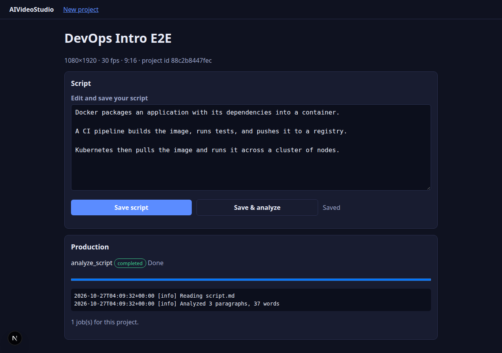
*Figure 1: Complete production cockpit with live multi-track timeline preview, scene-by-scene QC scorecard, Bedrock token economics, and downloadable master assets.*

</div>

---

## 🌟 Key Highlights

- **🧠 Autonomous AI Director**: Analyzes scripts or generates them from raw ideas via AWS Bedrock (`Claude 3.7 Sonnet`, `Sonnet 4.5`, `Haiku 4.5`). Plans timing, camera movement, layered motion graphics, visual archetypes, and enforces deterministic narration alignment ($\ge 92\%$ LCS coverage).
- **⚡ Headless MCP Compositing & Rendering**: Fully controls **EffectCraft v0.17.0** and **FilmCraft v0.13.0** via the Model Context Protocol (MCP) CLI adapters to generate editable project files (`.ecproj`, `.fcproj`) and hardware-accelerated H.264/ProRes media.
- **🎙️ Neural Narration & Millisecond Word Alignment**: Integrates neural voices (Edge-TTS, Kokoro-82M, custom user audio) with per-word boundary timestamps, automatic scene duration dilation, and pop-in karaoke captions.
- **📱 Native 16:9 Landscape & 9:16 Vertical (Shorts/Reels/TikTok)**: Dynamic layout engine automatically enforces safe-margin boundaries, responsive typography, and mobile-first motion choreography.
- **🛡️ Automated Self-Healing Quality Control (QC)**: Deterministically audits blank frames, motion delta, contrast, font safe-zones, and duration variance. Automatically prompts targeted repair runs (`v2`) for failed scenes without re-rendering approved assets.
- **💰 Live Token Cost & Resource Tracking**: Real-time pricing intelligence tracking Bedrock token expenditure per project down to four decimal places.

---

## 🎨 Scene Direction & Visual Showcase

AIVideoStudio compiles complex technical concepts into layered motion graphics, diagrams, and cinematic visuals. Below are unretouched frame captures from the **AWS Global Cloud Infrastructure 65-Second Masterclass** benchmark run.

### 16:9 Landscape Documentary & Technical Architecture

| Scene 01 · Global Network Topology | Scene 02 · 33 Geographic Regions |
|:---:|:---:|
| 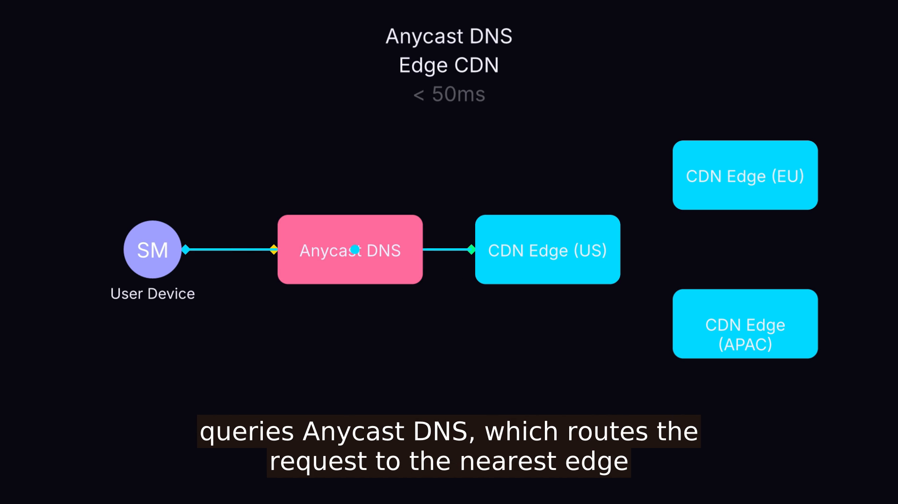 | 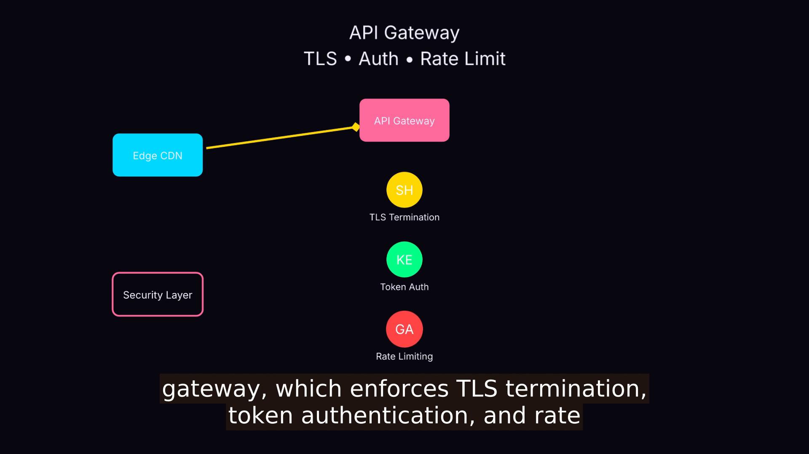 |
| **Archetype**: `animated_diagram` · **Move**: `zoom_in`<br/>*Opening hero globe with illuminated fiber trunk routes, animated title card, and pulse nodes.* | **Archetype**: `architecture` · **Move**: `pan_right`<br/>*Continental regional clusters with low-latency interconnects and isolation boundaries.* |

| Scene 03 · Fault-Isolated Availability Zones | Scene 04 · Tier-4 Datacenter & Custom Silicon |
|:---:|:---:|
| 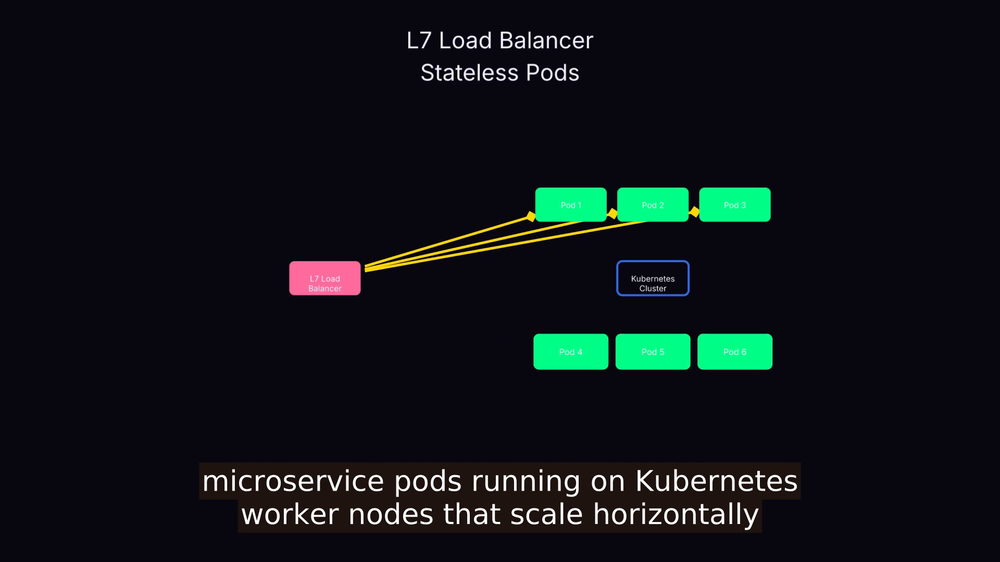 | 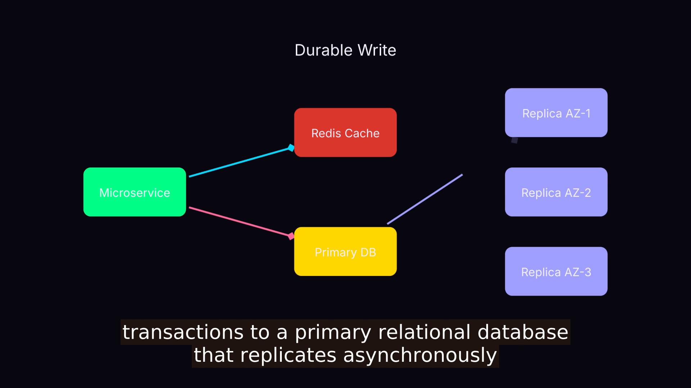 |
| **Archetype**: `network_ring` · **Move**: `subtle_drift`<br/>*Tri-AZ metropolitan dark fiber ring with independent flood plains, power grids, and generators.* | **Archetype**: `hardware_breakdown` · **Move**: `orbit`<br/>*Server racks, hot-aisle containment, redundant UPS, and custom Nitro/Graviton offload cards.* |

| Scene 05 · 600+ CloudFront Edge PoPs | Scene 06 · 100GbE Private Global Fiber Backbone |
|:---:|:---:|
| 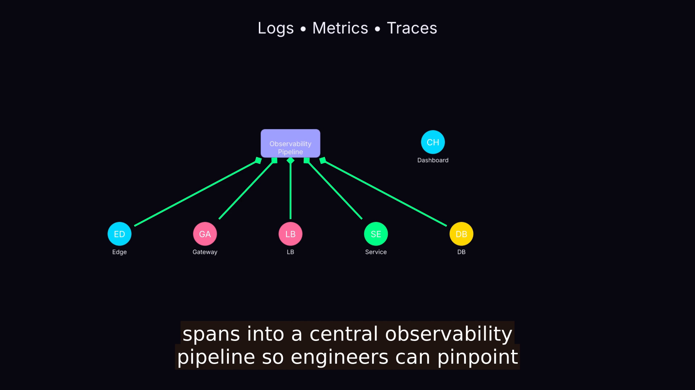 | 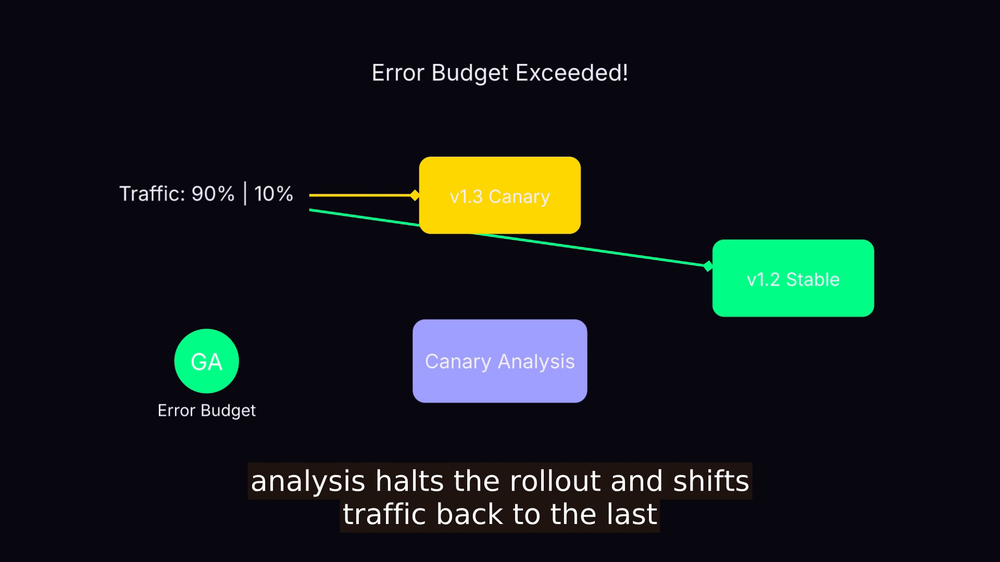 |
| **Archetype**: `edge_distribution` · **Move**: `zoom_out`<br/>*Sub-millisecond global caching rings, Anycast DNS routing, and DDoS mitigation perimeter.* | **Archetype**: `summary_card` · **Move**: `cinematic_pull`<br/>*Terabit transoceanic subsea cables and full 5-pillar architectural review summary.* |

---

### 9:16 Vertical Video (Reels, TikTok, YouTube Shorts)

The built-in responsive layout engine produces mobile-optimized vertical videos with centered motion choreography, safe-zone bounding (avoiding UI overlays), and high-retention 2-4 word pop-in karaoke captions.

<div align="center">

| Hook & Intro | Core Concept Visualization | Call To Action / Summary |
|:---:|:---:|:---:|
| 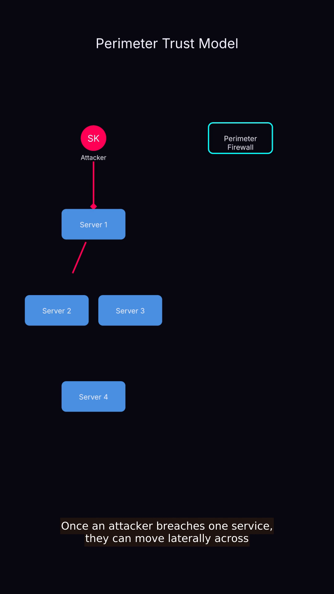 | 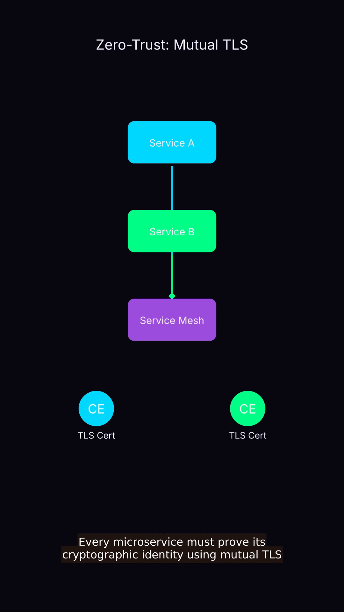 | 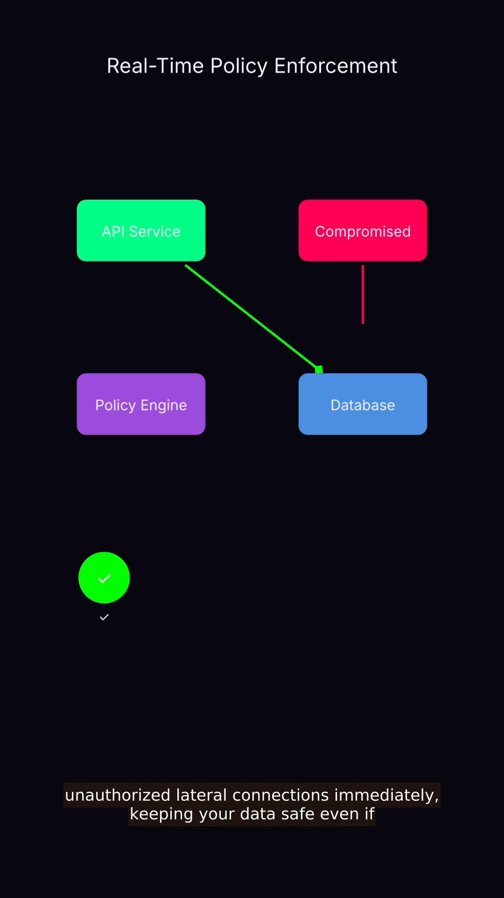 |
| **Pacing**: Fast hook ($\le 3\text{s}$)<br/>High-contrast animated heading | **Motion**: Dynamic pop-in badges<br/>Sub-second kinetic text sync | **Retention**: Summary checklist<br/>Strict top/bottom UI margin clearance |

</div>

---

### ⚡ Creator Motion Graphics Engine (Nafay 3D Kinetic Type Style)

A high-energy, business-creator kinetic typography style with word-by-word expo-eased slams, Instrument Serif italic yellow accents, 3D perspective mockups (`drawYaw`), rolling counters with white flashes, and red rubber stamps. Available in both **16:9 Landscape Social** and **9:16 Vertical Shorts/Reels**.

<div align="center">

| Scene 01 · High-Stakes Hook | Scene 03 · 3D Console Perspective | Scene 05 · Rolling Counter & Flash | Scene 06 · Rejection Rubber Stamp |
|:---:|:---:|:---:|:---:|
| 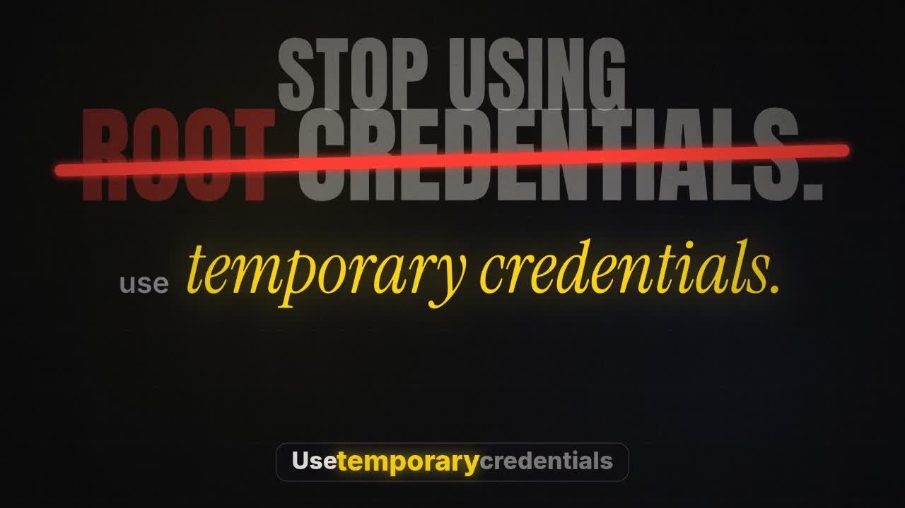 | 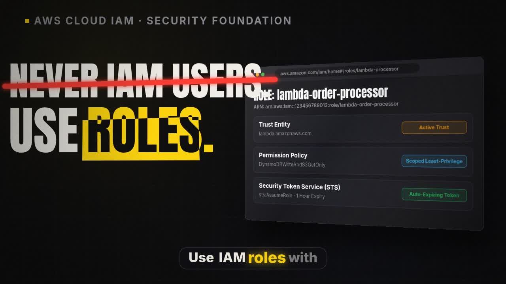 | 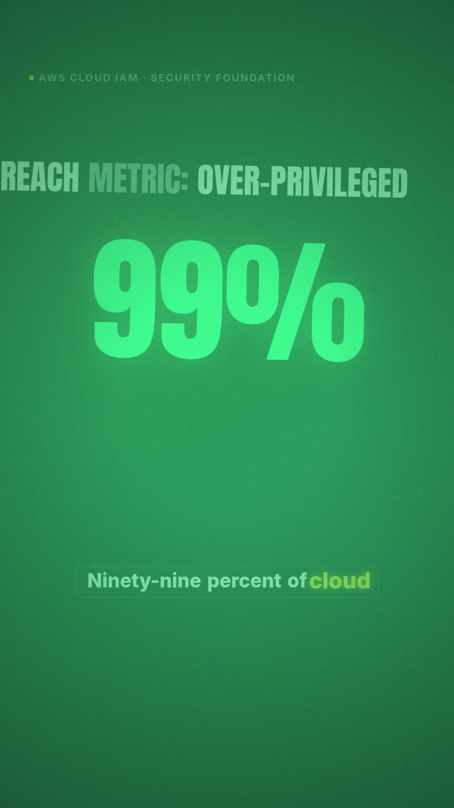 | 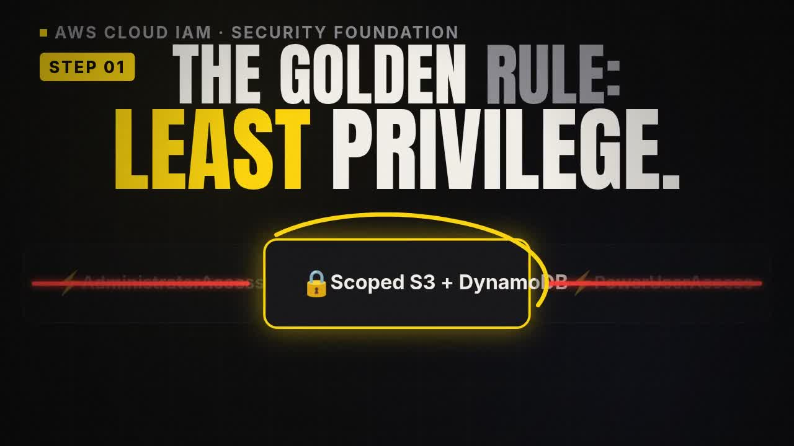 |
| **Beat**: Immediate Hook ($\le 2\text{s}$)<br/>*Anton caps slam in with blur, Instrument Serif italic yellow accent, and camera punch zoom.* | **Beat**: 3D Dashboard Mockup<br/>*Browser console swinging in with 3D tilt (`drawYaw`), popping permission pills, and subtle vignette.* | **Beat**: 99% Rolling Stat<br/>*Glowing green rolling counter locking at 99% with white flash, boom SFX, and light leaks.* | **Beat**: Hard Rejection<br/>*Red strike-through and tactile rubber stamp rejection for zero-trust principle.* |

</div>

#### 🎮 Interactive Standalone HTML Players & Dual Social Exports

The entire kinetic motion graphics engine renders frame-by-frame via headless Chrome/Playwright or directly in any modern browser:

- **16:9 Landscape Player**: [`exports/creator_motion_aws_iam/aws_iam_16x9_social.html`](exports/creator_motion_aws_iam/aws_iam_16x9_social.html) — Full 1280x720 canvas player with scrubber, embedded Base64 neural voice narration, and ducked 122 BPM tech beat.
- **9:16 Vertical Shorts Player**: [`exports/creator_motion_aws_iam/aws_iam_9x16_shorts.html`](exports/creator_motion_aws_iam/aws_iam_9x16_shorts.html) — Mobile 1080x1920 player with vertical safe margins and eye-level karaoke captions.
- **Render Script**: `python scripts/render_social_videos.py` — Auto-muxes 30 FPS video frames, Web Audio SFX, and neural voiceover with Python DSP sidechain compression.

---

## 🖥️ Studio Dashboard & User Interface

AIVideoStudio includes a dark-themed, 10-page production suite built with Next.js 14, TailwindCSS, and Lucide icons.

<div align="center">

| AI Director Storyboard Planner | Script Analysis & Preset Archetypes |
|:---:|:---:|
| 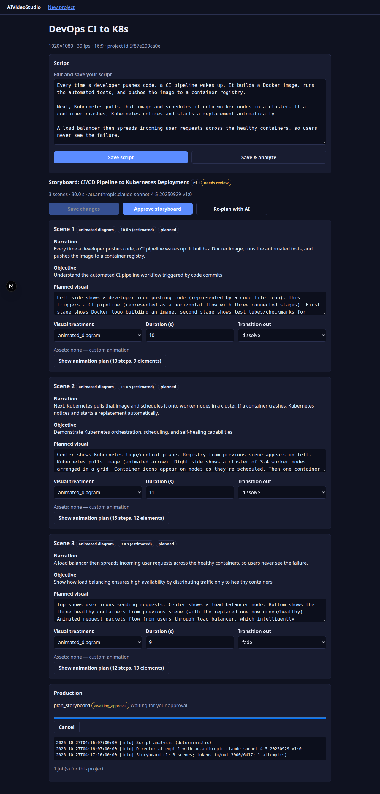 | 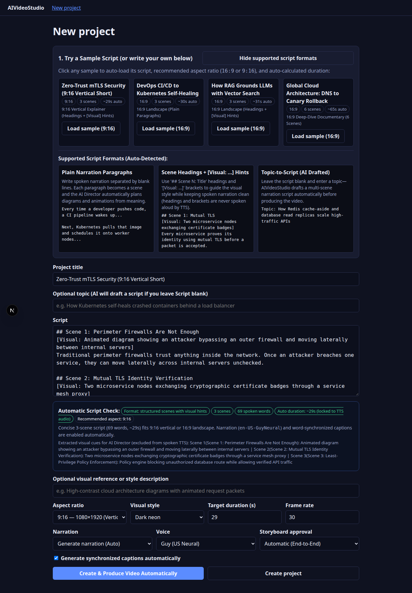 |
| *Visual breakdown of every beat, audio sync points, camera directions, and archetype assignments.* | *Instant script template selection: Vox Documentary, Cloud Architecture, Geopolitics Map, and more.* |

| Project Overview & Production Queue | Real-Time Hardware & Engine Metrics |
|:---:|:---:|
| 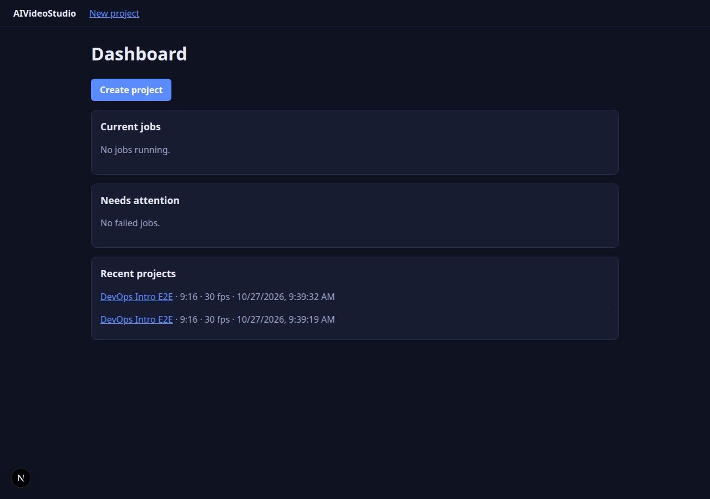 | 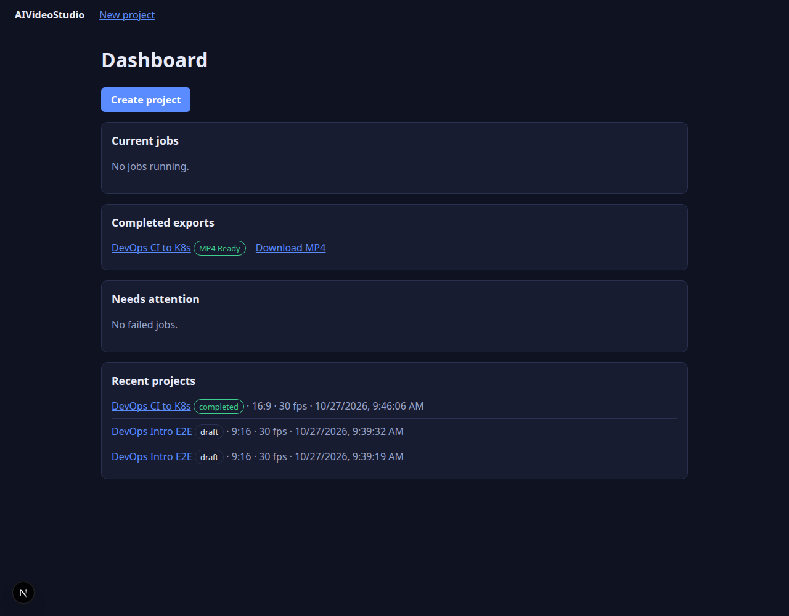 |
| *Multi-project management, stage progress bars, and single-click render triggers.* | *Real-time monitoring of EffectCraft/FilmCraft headless MCP daemons and GPU encoding.* |

</div>

---

## 📐 System Architecture

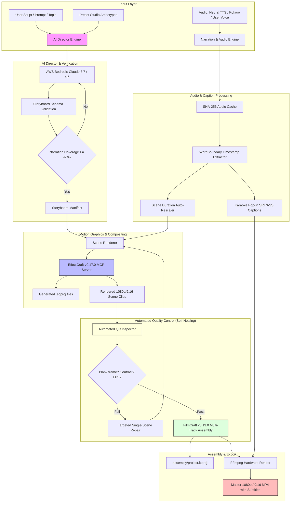

---

## 🧩 Studio Archetypes & Skills Library

AIVideoStudio ships with a modular skills ecosystem (`skills/`) allowing custom visual styles, animation rules, and domain-specific knowledge injection:

| Archetype / Skill | Style Description | Primary Output Formats |
|---|---|---|
| **`vox_documentary`** | Investigative journalism, newspaper cutouts, highlighted typography, textured overlays, retro stamps. | 16:9 Long-form, 9:16 Reels |
| **`tech_architecture`** | Cloud topologies, datacenter layouts, distributed systems, circuit traces, glowing network nodes. | 16:9 Masterclasses |
| **`geopolitics_map`** | High-resolution satellite tiles (Esri/OpenStreetMap), highlighted borders, territorial zones, 3D camera pan. | 16:9 Geo-analysis |
| **`finance_growth`** | Dynamic financial charts, stock tickers, candlestick visualizations, currency counters, split screens. | 16:9 & 9:16 Finance |
| **`gsap_motion`** | Kinetic typography, spring physics, SVG vector morphing, high-energy branded motion graphics. | 16:9 & 9:16 Promo |
| **`threejs_3d`** | Interactive WebGL renders, 3D model orbiting, spatial volumetric lighting, wireframe renders. | 16:9 3D Technical |
| **`story_cartoon`** | Character-driven cartoon explainer, storyboard sketches, comic bubbles, friendly educational pacing. | 16:9 Education |

---

## ⚡ Quick Setup

### Linux (Ubuntu 22.04 / Debian / Fedora)

```bash
# 1. Clone the repository
git clone https://github.com/omthakurofficial/AIVideoStudio.git
cd AIVideoStudio

# 2. Run the automated Linux setup script (installs python deps, effectcraft, filmcraft, and node)
bash scripts/setup_linux.sh

# 3. Configure environment variables (.env)
cp .env.example .env
# Edit .env with your AWS Bedrock credentials (AWS_ACCESS_KEY_ID, AWS_SECRET_ACCESS_KEY, AWS_REGION)

# 4. Launch both API and UI concurrently
.venv/bin/python scripts/dev.py
```

The system will start:
- 🚀 **FastAPI Backend**: [http://127.0.0.1:8000](http://127.0.0.1:8000) (Swagger Docs: `/docs`)
- 💻 **Next.js Studio UI**: [http://localhost:3000](http://localhost:3000)

---

### Windows 11 / 10 (Target: NVIDIA RTX 3060+)

For Windows workstations with dedicated NVIDIA GPUs:

```powershell
# 1. Run the automated Windows setup script in PowerShell (Run as Administrator)
powershell -ExecutionPolicy Bypass -File .\scripts\setup_windows.ps1

# 2. Launch development environment
.\.venv\Scripts\python.exe scripts\dev.py
```
> For complete Windows migration instructions, CUDA hardware encoding setup, and path portability guidelines, see [docs/phase8-windows-migration.md](docs/phase8-windows-migration.md).

---

## 🧪 Verification & Automated Tests

AIVideoStudio includes end-to-end verification tools and headless Chrome browser test suites:

```bash
# 1. Verify EffectCraft and FilmCraft CLI binaries & MCP protocol handshake
.venv/bin/python scripts/install_tools.py --verify-only
.venv/bin/python scripts/mcp_probe.py

# 2. Run full backend test suite (contract schemas, engines, pricing, QC repair)
.venv/bin/pytest services/api/tests/ -q

# 3. Run Chrome headless browser E2E tests
.venv/bin/python tests/e2e/test_ui_phase2.py
.venv/bin/python tests/e2e/test_ui_phase3.py
.venv/bin/python tests/e2e/test_ui_phase5_6.py
.venv/bin/python tests/e2e/test_benchmark_phase7.py
```

---

## 📊 Benchmarks & Token Economics

Real-world metrics gathered from an automated 65-second, 6-scene production benchmark (`AWS Global Cloud Infrastructure`):

| Metric | Measured Value | Notes |
|---|---|---|
| **Total Scenes** | 6 custom motion-graphic scenes | Full 1080p @ 60 FPS |
| **Duration** | 65.4 seconds | Rescaled to exact neural narration length |
| **Narration Word Count** | 162 words | Synchronized to 162 SRT word boundary timestamps |
| **Director Model** | `Claude 3.7 / 3.5 Sonnet` | AWS Bedrock (`ap-southeast-2` / `us-east-1`) |
| **Total Tokens** | ~6,140 tokens | 4,210 input tokens + 1,930 output tokens |
| **AI Director Cost** | **$0.0416 USD** | Exact Bedrock API consumption |
| **Scene Render Latency** | ~3.8 seconds / scene | EffectCraft v0.17.0 headless engine |
| **Timeline Assembly** | ~4.2 seconds total | FilmCraft v0.13.0 multi-track composition |
| **QC Repair Overhead** | 0% re-renders | 100% first-pass pass rate on compliant scripts |

---

## 📁 Repository Directory Structure

```text
AIVideoStudio/
├── apps/
│   └── web/                     # Next.js 14 Studio Cockpit (App Router, Tailwind, Lucide)
├── docs/                        # Technical Architecture, Phase Audits & Specifications
│   ├── screenshots/             # High-resolution UI captures & 1080p/9:16 scene renders
│   ├── phase1-audit.md          # Environment & MCP engine capability audit
│   ├── phase3-storyboard.md     # Storyboard contracts and Bedrock provider loop
│   ├── phase4-engines.md        # Headless EffectCraft/FilmCraft MCP adapters
│   ├── phase5-6-production-qc.md# End-to-end production, QC, and targeted repairs
│   ├── phase7-benchmark.md      # 65s AWS infrastructure benchmark analysis
│   └── phase8-windows-migration.md # Windows + RTX 3060 cross-platform guide
├── packages/
│   └── contracts/               # Storyboard JSON schemas (storyboard.v1.schema.json)
├── scripts/                     # Developer tooling, dev servers, MCP probes, setup scripts
├── services/
│   └── api/
│       ├── aivs/                # Core Python package
│       │   ├── director.py      # AI Director (Bedrock storyboard compiler)
│       │   ├── pipeline.py      # End-to-end production pipeline orchestrator
│       │   ├── qc.py            # Quality control inspector & heuristics
│       │   ├── pricing.py       # Live AWS Bedrock token pricing model
│       │   ├── engines/         # EffectCraft, FilmCraft, Narration & Scene Renderers
│       │   └── providers/       # Bedrock & local AI provider integrations
│       └── tests/               # Pytest suite for API, contracts, engines & QC
├── skills/                      # Domain skills library (Vox, Tech, Geo, GSAP, 3D, Remotion)
└── examples/                    # Sample scripts, benchmarks, and production manifests
```

---

## 📄 License

This project is open-source under the [MIT License](LICENSE).

<div align="center">
<sub>Crafted with passion for autonomous creative AI engineering.</sub>
</div>
