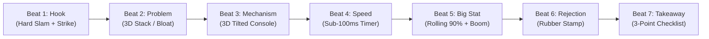

# 🎬 Creator Motion Graphics (Kinetic Type) — Script & Style Guide

A high-retention, code-driven motion graphics video system inspired by the **Nafay 3D / Business Creator** aesthetic. It uses pure HTML5 Canvas, Web Audio SFX, and local neural voiceover (Kokoro-82M) with **zero cloud tokens and zero Bedrock API dependencies**.

---

## 📐 1. Script Writing Formula & Beat Structure

This style works best at **30 to 60 seconds**.
- **Speaking Rate**: `150 words per minute` ($\approx 2.5\text{ spoken words per second}$).
- **30-Second Video**: **70 – 85 words** across **6 – 7 distinct visual beats** (~4–5s per beat).
- **60-Second Video**: **140 – 150 words** across **8 – 10 distinct visual beats** (~5–6s per beat).

### 7-Beat Core Story Blueprint

Every video follows this psychological retention structure:



| Beat | Duration | Narration Goal | Visual Motion Primitive | Key Sound Cue |
| :--- | :--- | :--- | :--- | :--- |
| **Beat 1: The Hook** | $0.0\text{s} - 4.5\text{s}$ | Call out the mistake or orthodox belief immediately. | `slam()` big Anton caps with motion blur $\to$ red `strike()` through wrong phrase $\to$ Instrument Serif yellow italic accent lands. | `slam` + `strike` + `pop` |
| **Beat 2: The Problem** | $4.5\text{s} - 10.5\text{s}$ | Expose the hidden cost, bloat, or danger. | `drawYaw()` 3D perspective architecture stack showing layered components with dark red warning badges popping in with overshoot. | `whoosh` + `glitch` + `pop` |
| **Beat 3: The Secret Mechanism** | $10.5\text{s} - 15.5\text{s}$ | Introduce the real solution & how it works. | 3D tilted browser/console window (`drawYaw`) with macOS traffic lights, active tab, and isolated feature pills. | `pop` + `marker` + `click` |
| **Beat 4: Speed / Performance** | $15.5\text{s} - 20.5\text{s}$ | Show how fast, efficient, or responsive it is. | High-speed rolling millisecond speedometer (e.g. `0ms ➔ 85ms`) + 3 lightweight cards popping in with overshoot. | `tick` (fast) + `pop` |
| **Beat 5: Key Proof Number** | $20.5\text{s} - 27.5\text{s}$ | Lock in the undeniable metric/statistic. | Big glowing green rolling counter (`0% ➔ 90%` or `99%`) locking with a white screen flash, screen shake, and highlighter swipe. | `boom` + `shimmer` + `slam` |
| **Beat 6: The Flat Rejection** | $27.5\text{s} - 30.5\text{s}$ | Discard the obsolete alternative completely. | Giant red caps struck out $\to$ heavy tactile red rubber stamp **`[ DEPRECATED ]`** slams down with camera shake and dust burst. | `strike` + `stamp` |
| **Beat 7: Takeaway & Action** | $30.5\text{s} - 33.0\text{s}$ | Clear 3-point takeaway and final call-to-action. | 3 animated checkmark badges popping in sequentially (`✓`) + golden CTA hero card holding until the end. | `pop` + `pop` + `pop` |

---

## 📝 2. Script Markup Template (Copy & Edit)

Use this format when writing or prompting scripts for this engine:

```markdown
TOPIC: Docker Containers
DURATION: 32 Seconds (88 Words)
VOICE: am_adam (Kokoro Neural)
FORMAT: Dual 16:9 Landscape & 9:16 Shorts

[BEAT 1: HOOK] (0.0s - 4.2s)
Narration: Stop deploying entire virtual machines just to run a single service.
Visual: [SLAM: STOP DEPLOYING] [SLAM_RED: VIRTUAL MACHINES] [STRIKE] [SERIF_YELLOW: just for a single service.]
Camera: Punch zoom on "VIRTUAL MACHINES" + subtle shake.

[BEAT 2: PROBLEM ARCHITECTURE] (4.2s - 10.7s)
Narration: Traditional VMs carry full guest operating systems, massive memory overhead, and minute-long cold boots.
Visual: [3D_YAW: VM Architecture Stack] [BADGE_RED: 4096 MB RAM BLOAT] [PILL_RED: COLD BOOT: 60 SECONDS]
Transition: Whip pan right (0.28s).

[BEAT 3: THE SECRET ENGINE] (10.7s - 15.4s)
Narration: Docker changes everything by sharing the host Linux kernel through namespaces and cgroups.
Visual: [3D_YAW: Docker Engine Dashboard] [PILLS: PID Namespace, NET Namespace, cgroups] [BASE_GLOW: Shared Host Linux Kernel]
Transition: RGB Glitch cut (0.24s).

[BEAT 4: SPEED & ISOLATION] (15.4s - 20.4s)
Narration: Processes run isolated in lightweight containers that spin up in under one hundred milliseconds.
Visual: [SPEEDOMETER: 0ms -> 85ms in Glowing Green] [OVERSHOOT_CARDS: nginx:alpine, node:api, redis:cache]
Transition: Vertical whip cut (0.26s).

[BEAT 5: THE KEY METRIC] (20.4s - 27.6s)
Narration: Ninety percent less memory overhead, zero guest OS bloat, and identical environments from local dev to production.
Visual: [ROLLING_STAT: 0% -> 90%] [LOCK: White Flash + Screen Shake] [HIGHLIGHTER_SWIPE: DEV TO PROD PARITY]
Transition: White flash cut (0.16s).

[BEAT 6: FLAT REJECTION] (27.6s - 30.3s)
Narration: Stop running monolithic infrastructure.
Visual: [SLAM_RED: MONOLITHIC INFRASTRUCTURE] [STRIKE] [RUBBER_STAMP: DEPRECATED]
Camera: Heavy camera shake on stamp landing.

[BEAT 7: CREATOR TAKEAWAY] (30.3s - 32.65s)
Narration: Containerize your stack today.
Visual: [CHECKLIST: ✓ Sub-100ms Starts, ✓ 90% Less Memory, ✓ Dev-Prod Parity] [GOLD_CTA: CONTAINERIZE YOUR STACK TODAY]
Hold: 1.5s until end.
```

---

## 🎨 3. The Visual Style Engine (How to Change into a New Version)

Every visual style in this engine is a pure JavaScript object and set of Canvas functions. To create a new style version (e.g. `v2: Cyberpunk Neon`, `v3: Minimal Light Tech`, `v4: Swiss Clean`), you only modify these parameters:

### 1. Palette (`C`)
```javascript
// Style v1 (Current: Near-Black Editing Suite)
const C_v1 = {
  bg: '#09090b',         // Dark graphite
  ink: '#f4f1ea',        // Warm off-white
  dim: '#8e8d94',        // Neutral gray
  accent: '#ffd60a',     // Vibrant creator yellow
  green: '#30d158',      // Neon stat green
  red: '#ff3b30',        // Tactical red
  cyan: '#38bdf8'        // Electric blue
};

// Style v2 (Cyberpunk Dark Neon)
const C_v2 = {
  bg: '#050508',
  ink: '#ffffff',
  dim: '#6b7280',
  accent: '#00f0ff',     // Cyan laser
  green: '#10b981',
  red: '#ff0055',        // Magenta laser
  cyan: '#8b5cf6'        // Violet
};

// Style v3 (Clean Minimal Paper Light)
const C_v3 = {
  bg: '#f8f9fa',
  ink: '#111827',
  dim: '#6b7280',
  accent: '#f59e0b',     // Warm amber
  green: '#059669',
  red: '#dc2626',
  cyan: '#2563eb'
};
```

### 2. Typography Rules (`F`)
```javascript
// Font Family Triad
const F = {
  display: '"Anton", "Bebas Neue", Impact, sans-serif',  // Statements, big caps (80px - 220px)
  serif:   '"Instrument Serif", Georgia, serif',         // Emotional / accent phrase (italic, yellow)
  body:    '"Inter", system-ui, sans-serif'              // Labels, pills, body cards, code
};
```
*Rule*: Never use more than one serif italic phrase per line. Statement text must stay above 80px on 1280x720.

### 3. Motion Primitives
- **`slam(c, item, t)`**: Words scale down from `1.45x` to `1.0x` with motion blur settling via `ez.outExpo()`.
- **`drawYaw(c, canvasLayer, cx, cy, w, h, yaw, alpha)`**: 3D perspective projection simulating camera rotation around the Y-axis.
- **`strike(c, x0, x1, y, progress, color)`**: Dynamic hand-drawn strikethrough with glowing shadow.
- **`stampLayer(text, color)`**: Procedural rubber stamp with noise mask erosion and imperfect ink stamp edges.
- **`swipe(c, item, t, t0, dur)`**: Organic highlighter mark that turns text underneath into black.

### 4. Synthesized SFX Kit (Zero External Audio Files)
All sound effects are generated mathematically inside the browser via Web Audio API oscillators and noise buffers:
- **`slam`**: Low sine sweep (150Hz $\to$ 52Hz) + lowpass noise burst.
- **`boom`**: Sub-bass (90Hz $\to$ 34Hz) + brown noise + ducking trigger.
- **`pop`**: High resonant pop (760Hz) with rapid decay.
- **`marker`**: Bandpassed noise streaks simulating dry-erase marker on whiteboard.
- **`stamp`**: Double-thud transient + low resonant body.
- **`whoosh`**: Pink noise frequency sweep with stereo panning.
- **`glitch`**: Random high-frequency square wave bursts.
