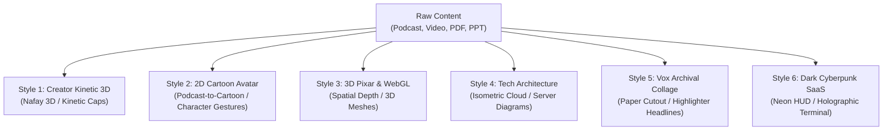

# 🎨 02 · Animation Style Recreator & Character Engine

> **Attach this file to ChatGPT, Gemini, or Claude.**
> Provides the complete catalog of animation archetypes (2D/3D Cartoon, Podcast-to-Avatar, Creator Kinetic, Vox Paper, Tech 3D) and rules for converting live-action footage or business content into animated masterpieces.

---

## 🎭 The 6 Master Animation Styles

When recreating original content, select or combine any of these 6 styles:

---

### Style 1: Creator Motion & Kinetic Typography (Nafay 3D)
- **Best For**: High-energy tech reels, marketing hooks, SaaS explainers, business tips.
- **Visuals**:
  - Near-black `#09090b` canvas with drifting subtle grid and 24fps film grain.
  - Huge condensed caps (`Anton` 80–220px) slamming in with motion blur and expo-ease.
  - One yellow emotional accent phrase in `Instrument Serif` italic.
  - 3D tilted browser and phone console mockups (`drawYaw`).
  - Rolling neon green counter locking with a white flash and boom SFX.
  - Tactile procedural red rubber stamp (`[ DEPRECATED ]`, `[ EXPOSED ]`).

---

### Style 2: 2D Cartoon Character & Podcast-to-Avatar (Oversimplified / Kurzgesagt)
- **Best For**: Converting live podcasts, interviews, talking-head videos, or music videos into animated cartoon shorts.
- **Presenter Transformation**:
  - Extracts real speaker's key physical traits: hairstyle, facial hair, glasses, hoodie/suit, signature microphone.
  - Generates a vector/cartoon character counterpart.
- **Emotional Expressiveness & Gestures**:
  - `[EMOTION: LAUGH]` ➔ Wide smiling mouth, squinting eyes, bouncy vibrating head, laugh tear particles.
  - `[EMOTION: SHOCK / SURPRISE]` ➔ Jaw-drop, wide white eyes with tiny pupils, exclamation marks popping.
  - `[EMOTION: MOTIVATIONAL]` ➔ Clenched fist pump, fiery comic speed lines in background, intense eye glint.
  - `[EMOTION: SKEPTICAL / SUSPICIOUS]` ➔ One raised eyebrow, squinting glance, chin scratch with hand.
  - `[EMOTION: DEEP_THINKING]` ➔ Thought bubble popping up with cartoon question marks or floating math formulas.
- **Character Staging**: Character positioned on left or bottom third, reacting dynamically to floating props.

---

### Style 3: 3D Pixar / WebGL Spatial Style
- **Best For**: Futuristic storytelling, AI explainers, cinematic shorts.
- **Visuals**:
  - 3D stylized character avatar with soft studio lighting, ambient occlusion, and subsurface skin scattering.
  - Dynamic orbital camera rotating around the subject.
  - Depth of field (bokeh blur) separating foreground character from floating UI badges.

---

### Style 4: Tech & Cloud Architecture (ByteByteGo / Cloud Style)
- **Best For**: AWS/GCP system design, database internals, networking, DevOps.
- **Visuals**:
  - Dark slate technical canvas (`#0f172a`).
  - Isometric 3D server racks, AWS service tiles (Lambda, S3, RDS, DynamoDB).
  - Glowing pulse lines showing API requests, TCP packets, and load balancer distribution.
  - Red flashing fault icons simulating regional datacenter failovers.

---

### Style 5: Vox Archival Collage & Paper Cutout
- **Best For**: Historical explainers, journalism, geopolitical documentaries, deep-dive investigations.
- **Visuals**:
  - Cream textured archival paper background with faint blueprint grid.
  - White-bordered photo cut-outs with realistic drop shadows and paper-tape strips.
  - Yellow highlighter marker sweeping across authentic newspaper headlines.
  - Hand-drawn curved editorial arrows and dashed route lines.

---

### Style 6: Dark Cyberpunk & SaaS Terminal
- **Best For**: Developer tools, cybersecurity, crypto, high-frequency trading.
- **Visuals**:
  - Void black canvas (`#050508`) with laser cyan and magenta grid lines.
  - Glowing code editor windows with syntax-highlighted TypeScript, Rust, or Python.
  - Holographic HUD cards with live data streams and animated radar sweeps.

---

## 🔄 Rules for Cross-Style Content Recreation

When transforming original content:
1. **Never change the truth**: Keep the facts, logic, and numbers identical.
2. **Upgrade the medium**: Replace boring talking-head pauses with character emotion, kinetic visual proof, and dynamic camera choreography.
3. **Maintain emotional authenticity**: If the host laughs in the podcast, the cartoon avatar laughs. If the speaker gets serious, the camera punches in and the background darkens.
