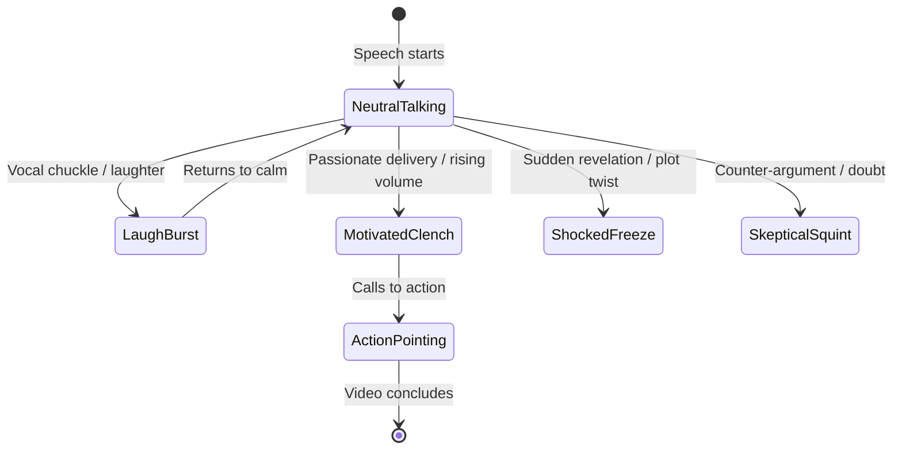

# 🎭 03 · Character Emotion, Acting & B-Roll Layering

> **Attach this file to ChatGPT, Gemini, or Claude.**
> Instructs the AI how to direct character avatars, facial acting, emotional sync, and layered B-roll cutaways.

---

## 😃 1. Character Emotional Arc & Facial Acting Engine

When transforming a podcast, interview, or presenter video into a cartoon, the character must never stand static like a cardboard cutout. Every emotional shift in the voice triggers an animated state:

### Emotion Cue Catalog

| Emotional Trigger in Voice | Visual Facial Expression | Body Language & Gestures | Background / Prop FX |
| :--- | :--- | :--- | :--- |
| **`[ACT: LAUGH]`** | Eyes closed squinting, mouth wide open in curved smile, blush cheeks. | Shoulders vibrating rapidly up and down, head tilted back, one hand on stomach. | Sparkle burst particles, floating tear drops of joy. |
| **`[ACT: MOTIVATED]`** | Determined brow furrow, shining eye glint, firm mouth articulation. | Clenched fist thrust forward or pumping in the air, chest puffed out. | Manga speed lines converging on character, warm fiery aura glow. |
| **`[ACT: SHOCKED]`** | Jaw dropped below normal chin, white wide eyes, floating sweat drop. | Both hands clutching head or cheeks, body frozen stiff. | Dramatic blue vertical gloom lines (`anime shock lines`), screen shake. |
| **`[ACT: SKEPTICAL]`** | One eyebrow raised high, side-eye glance, mouth skewed to one side. | Arms crossed over chest, index finger tapping chin thoughtfully. | Floating question marks (`? ? ?`), magnifying glass prop. |
| **`[ACT: ANGRY / FRUSTRATED]`** | Red steaming face, sharp zig-zag mouth, narrowed intense eyes. | Both fists slamming down on imaginary or floating desk. | Smoke puffing from ears, dark red background flash. |
| **`[ACT: EXPLAINING / TEACHING]`** | Warm open friendly smile, dynamic mouth flaps synced to syllables. | Open palms gesturing outward, index finger pointing upward on key points. | Floating blackboard / holographic whiteboard with animated chalk drawings. |

---

## 🎬 2. B-Roll Layering & Visual Cutaways

Do not keep the camera stuck on the character 100% of the time. Use dynamic staging:

### Staging Layouts

1. **Full-Body Hero Shot (0% to 20% of scene duration)**:
   - Character centered or in the lower third, introducing the topic.
2. **Split Screen / PIP (Picture-in-Picture) (20% to 70% of scene duration)**:
   - Character shrinks to bottom-left corner (`35% scale`), gesturing toward the main center screen.
   - The center screen displays:
     - 3D tilted browser / mobile mockup (`drawYaw`)
     - Animated vector code editor or architecture flow
     - Historical photo or newspaper headline
3. **Full B-Roll Immersion Cutaway (70% to 90% of scene duration)**:
   - Character drops out completely for 2–3 seconds while a massive key metric (e.g. `90% Rolling Counter` with white flash) takes over the full 1080p canvas.
4. **Closing CTA Return (90% to 100% of scene duration)**:
   - Character reappears front and center, smiling, waving or pointing down to the subscribe/action badge.

---

## 🏷️ 3. Brand Assets, Logos & PNG Graphics Integration

Every video script must designate placements for custom user assets:
- **Logo Placement**: Fixed in top chrome header (`W - 140px, top: 48px` on 16:9; `top: 180px` on 9:16).
- **Custom PNG Cutouts**: Placed on floating glass cards with subtle vertical float (`Math.sin(t * 2) * 8px`).
- **SVG Icons**: Pop with elastic overshoot (`ez.outBack`) when mentioned in narration.
