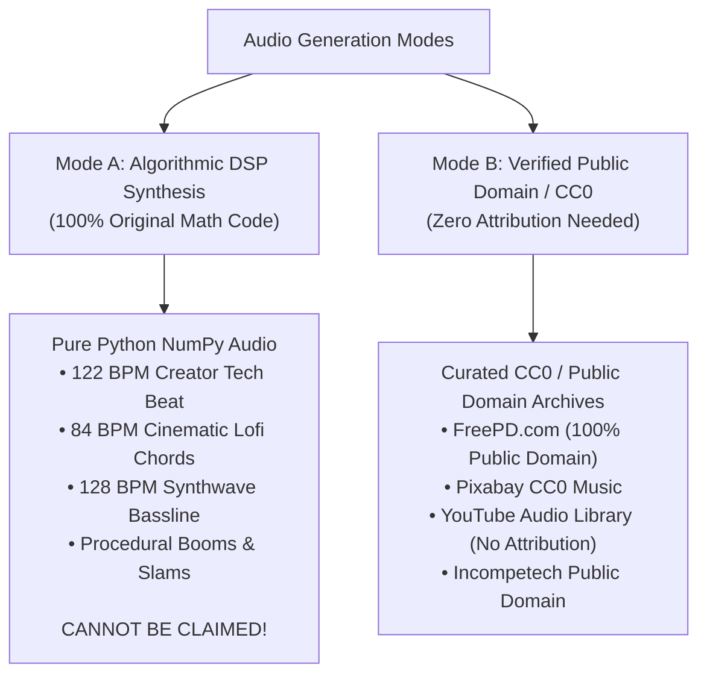

# 🎵 06 · Film Audio Mixing & 100% Copyright-Free Music Engine

> **Attach this file to ChatGPT, Gemini, or Claude.**
> Teaches the AI how to score background music, sound effects, and sidechain ducking like a Hollywood film sound designer—with **zero copyright strikes or ContentID claims** on YouTube, TikTok, Instagram, or Facebook.

---

## 🛡️ 1. Why You Will NEVER Get a Copyright Strike

Copyright strikes happen when creators use commercial songs or stock music registered with YouTube ContentID or TikTok Music Registry.

AIVideoStudio solves this permanently through **two zero-stress methods**:



### Mode A: 100% Pure Mathematical DSP Synthesis (Default)
- The background beats, 808 kicks, synth chords, and SFX are **synthesized live from scratch using mathematical differential equations and sine/saw/noise waveforms** in Python (`packages/creator_engine/music_composer.py`).
- **Result**: It is an original musical piece generated on your machine. No robot or ContentID fingerprint on earth matches it, guaranteeing **100% monetization safety**.

### Mode B: Curated Royalty-Free & CC0 Public Domain Archives
If you prefer adding pre-recorded tracks, these platforms offer 100% copyright-free, strike-proof audio:
1. **FreePD.com**: 100% Public Domain (CC0). No attribution required, free for commercial use.
2. **Pixabay Music (pixabay.com/music)**: Free commercial license, safe for YouTube and TikTok.
3. **YouTube Audio Library**: Google's official monetization-cleared sound bank.
4. **Incompetech (incompetech.com)**: Kevin MacLeod's royalty-free creative commons library.

---

## 🎚️ 2. The Film Composer's 4-Bus Mixing Architecture

Professional video editors and film composers never paste music at a fixed volume. They use a **4-Bus Mixing Architecture**:

```
+-------------------------------------------------------------------------------+
| BUS 1: DIALOGUE (VOICEOVER)                                                   |
| - Kokoro Neural Speech (am_adam / am_michael)                                 |
| - Front & Center, Soft Saturation (tanh), High-pass filter at 80Hz            |
| - Target Level: -14 LUFS Broadcast Standard                                   |
+-------------------------------------------------------------------------------+
       |
       v (Sidechain Envelope Detector)
+-------------------------------------------------------------------------------+
| BUS 2: BACKGROUND MUSIC (DYNAMIC SIDECHAIN DUCKING)                           |
| - Speaking State: DUCKED by -14 dB (Level: 0.18 - 0.22) so voice is crystal clear|
| - Silence / Pause / Cut: SWELLS by +6 dB (Level: 0.58 - 0.62) for punchy beats|
+-------------------------------------------------------------------------------+
       +
+-------------------------------------------------------------------------------+
| BUS 3: SOUND DESIGN & FOLEY (SFX HITS)                                        |
| - Slams on hook words, booms on stat locks, whooshes on cuts, stamp thuds      |
+-------------------------------------------------------------------------------+
       +
+-------------------------------------------------------------------------------+
| BUS 4: AMBIENCE & ROOM TONE                                                   |
| - Subtle 24fps vinyl crackle / tape hiss / sub drone to glue mix together     |
+-------------------------------------------------------------------------------+
       |
       v
=================================================================================
MASTER LIMITER: -1.0 dBFS True Peak (Zero Distortion, Zero Clipping, Clean Output)
=================================================================================
```

---

## 🎹 3. Available Musical Genres (Zero Copyright)

You can select any of these algorithmic genres in your prompt:

1. **`creator_tech` (122 BPM)**:
   - High-energy modern tech creator beat.
   - 808 sub kick, snappy clap on beats 2 and 4, rolling 16th hi-hats, F-minor synth bass.
2. **`lofi_documentary` (84 BPM)**:
   - Warm, reflective Vox-style documentary score.
   - Electric piano chord progression (Dm9 ➔ G13 ➔ Cmaj9 ➔ Am7), soft vinyl crackle ambience.
3. **`cyberpunk_synthwave` (128 BPM)**:
   - Driving analog saw bassline arpeggio with 4-on-the-floor kick and gated synth stabs.
4. **`playful_cartoon` (115 BPM)**:
   - Bouncy, lighthearted comedic rhythm for cartoon animations and podcast clips.

---

## 🔊 4. Sound Effects (SFX) Score Sheet

When ChatGPT, Gemini, or Claude writes your script, it assigns exact SFX cues to words:

| SFX Name | Trigger Point in Script | Audio Characteristic |
| :--- | :--- | :--- |
| **`slam`** | Hard hook words, opening caps | Low sine drop (150Hz ➔ 50Hz) + transient click |
| **`boom`** | 90% stat lock, major breakthrough | Sub-bass impact (85Hz ➔ 30Hz) + brown noise tail |
| **`stamp`** | `[ DEPRECATED ]` / `[ EXPOSED ]` | Heavy wooden thud + double impact body |
| **`whoosh`** | Whip pan transitions between scenes | Filtered pink noise sweep with stereo panning |
| **`glitch`** | RGB glitch cuts, error reveals | High-frequency square-wave stutter bursts |
| **`marker`** | Highlighter swipe across text | Bandpassed scratch simulating marker on whiteboard |
| **`pop`** | Cards, badges, pills popping in | High resonant sine chirp (820Hz) with 80ms decay |
| **`tick`** | Speedometer & millisecond timers | Crisp high-frequency clicks (12 per second) |
| **`tape_stop`**| Pitch drop on fatal flaw / wrong idea | Analog tape motor slowdown pitch-drop |
